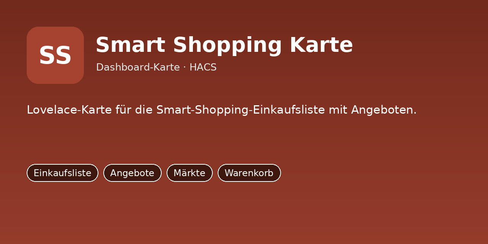
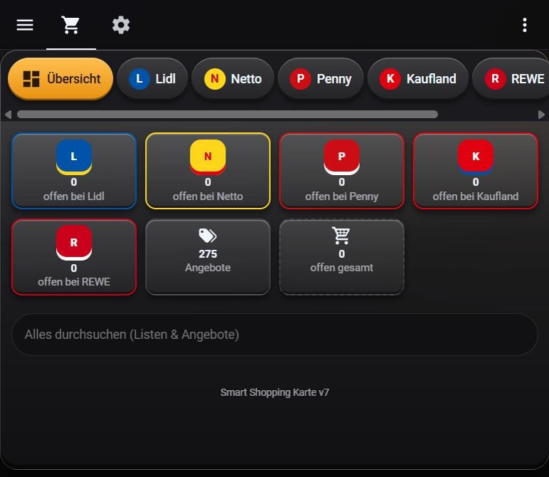

# Smart Shopping Card





Lovelace-Karte für Einkaufslisten je Markt (Lidl, Netto, Penny, Kaufland, REWE) mit Angebotsvorschlägen.
Gehört zur Integration **ha-smart-shopping-integration** (liefert `sensor.smart_shopping_angebote`,
`/local/smart_shopping/offers.json` und den Dienst `smart_shopping.angebote_aktualisieren`).

## Installation (HACS)

1. HACS → ⋮ → **Benutzerdefinierte Repositories** → dieses Repo als Kategorie **Dashboard** hinzufügen.
2. **Smart Shopping Card** installieren. HACS legt die Ressource meist selbst an. Falls nicht:
   Einstellungen → Dashboards → ⋮ → Ressourcen → `/hacsfiles/ha-smart-shopping-card/smart-shopping-card.js` als *JavaScript-Modul*.
3. Karte einbinden:

```yaml
type: custom:smart-shopping-card
```

Die Karte nutzt die To-do-Listen `todo.lidl`, `todo.netto`, `todo.penny`, `todo.kaufland`, `todo.rewe`.

## Änderung gegenüber v7 (YAML-Paket)

Der Aktualisieren-Knopf ruft jetzt den Dienst `smart_shopping.angebote_aktualisieren` auf statt des Skripts
`script.smart_shopping_refresh_offers`. Sonst ist die Karte unverändert.
